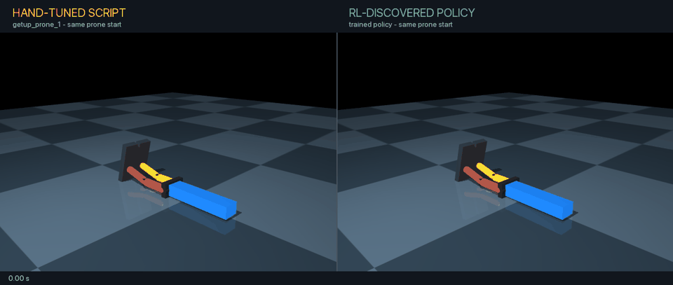

# Planar LEGO biped

Side-by-side: hand-tuned `getup_prone_1` and the RL-trained policy, both from
the prone keyframe. [Play/download the MP4](assets/getup-policy-comparison.mp4).



This is a deliberately small bridge between the rotary pendulum and a fully
3-D walking robot.

## Physical idea

- Standard LEGO/Technic dimensions are used as the design grid.
- Four actuators: left/right hip and left/right knee.
- Fixed ankles and broad feet in version 1.
- The torso is constrained to the sagittal plane: it may move forward/up and
  rotate forward/backward, but cannot fall sideways or yaw.
- Primitive collision boxes and capsules come first.  Decorative meshes can be
  added after the dynamics work.

Nominal LEGO dimensions used here:

- stud pitch: 8 mm
- plate height: 3.2 mm
- brick height: 9.6 mm
- Technic-hole pitch: 8 mm

The current masses are explicit placeholders.  Before building a real robot,
we will weigh the completed torso, each thigh, each shin, and each foot and
replace them.

Current geometry revision:

- each foot is 240 mm long (twice the original length) and centred on the leg,
  extending 120 mm forward and 120 mm backward;
- the torso is 288 mm tall (twice the original height), with its lower edge and
  hip location unchanged;
- the mass values have deliberately not been doubled; they remain placeholders
  until the physical parts are weighed.

## Milestone 1: scripted motions (no RL)

The acceptance tests are:

1. `walk`: move forward at least 20 cm, finish upright, and remain standing
   for two seconds;
2. `getup_prone`: begin face-down, finish upright, and remain standing for two
   seconds;
3. `getup_supine`: begin face-up, finish upright, and remain standing for two
   seconds.

Current status: the XML model loads and the unperturbed robot stands stably.
After iterative manual tuning, `getup_prone_1` now gets the robot from its
face-down reset to standing.  The walking and supine get-up motions remain
unfinished; the first walking draft moves forward but falls at the end.

Run a motion in the interactive viewer:

```bash
/Users/adityasudhakar/toy-cleaner/.venv312/bin/mjpython \
  lego-biped/scripted_motions.py walk
```

Add `--headless` for a numerical check without opening the viewer.

The scripted controller sends joint-position targets at 50 Hz.  MuJoCo runs
the underlying physics at 1 kHz between those commands.

## PPO get-up experiment

`biped_env.py` exposes the four joint-position targets as incremental actions
at 50 Hz.  Each RL step advances 20 MuJoCo physics steps.  Training uses a
curriculum that moves resets from near-standing poses toward the exact prone
keyframe; evaluation always begins at the exact prone keyframe.

Run the environment/API check:

```bash
/Users/adityasudhakar/toy-cleaner/.venv312/bin/python \
  lego-biped/biped_env.py
```

Train 300,000 PPO timesteps:

```bash
/Users/adityasudhakar/toy-cleaner/.venv312/bin/python \
  lego-biped/train_rl.py --timesteps 300000 --run-name getup_300k_v2
```

Watch the best saved policy (`P` pauses and `R` resets):

```bash
/Users/adityasudhakar/toy-cleaner/.venv312/bin/mjpython \
  lego-biped/watch_rl.py
```

Current result (seed 42, 300,000 steps): **failed**.  The best
deterministic policy raised the torso from prone to about 0.174 m and reached
an upright orientation, but it did not reach the 0.28 m height threshold or
hold a full stand.  It scored 0/5 deterministic and 0/50 stochastic prone
successes.  Checkpoints and evaluation logs are in
`checkpoints/getup_300k_v2/`.

## Separate standing-only sway experiment

This experiment starts from the standing keyframe. It is useful only for
studying balance corrections after standing; it is **not** the main task of
getting up from prone without foot sway.

Train the standing-only experiment:

```bash
/Users/adityasudhakar/toy-cleaner/.venv312/bin/python \
  ./lego-biped/train_stand_sway.py --timesteps 300000 --n-envs 8
```

Watch the final trained policy (`P` pauses and `R` resets):

```bash
/Users/adityasudhakar/toy-cleaner/.venv312/bin/mjpython \
  ./lego-biped/watch_stand_sway.py
```

## Earlier PPO objective: prone to stand with minimal foot sway

The task starts from the prone keyframe and aims to complete the full
`getup_prone_1` routine, then hold a full stand for two seconds. The known
successful script initializes the policy through behavior cloning; PPO then
trains for its requested timestep budget. Planted-foot movement is penalized
throughout the get-up and stand hold, with a stronger coefficient than in the
first draft. Evaluation reports both full-stand success and mean planted-foot
sway so a quick stand is not mistaken for a good result.

In this earlier reward, the foot-sway coefficient was increased from `0.01`
to `5.0` so it could meaningfully compete with standing and height rewards.

Train a fresh run:

```bash
/Users/adityasudhakar/toy-cleaner/.venv312/bin/python \
  lego-biped/train_keyframe_transition.py --timesteps 300000 --n-envs 8
```

Watch the final trained policy (`P` pauses and `R` resets):

```bash
/Users/adityasudhakar/toy-cleaner/.venv312/bin/mjpython \
  lego-biped/watch_keyframe_transition.py
```

PPO runs for the full timestep budget unless interrupted. With 8 environments
and 512 steps per environment per rollout, one PPO update is 4,096 aggregate
transitions; 300,000 timesteps is about 74 updates. Evaluations run every
10,000 timesteps. The final policy is saved at
`lego-biped/checkpoints/prone_keyframe_transition/transition_ppo_final.zip`.
The older `best/best_model.zip` predates the corrected training setup and
should not be used for this task.

Result (seed 42): the final trained policy completed the prone-to-stand task
in 20/20 deterministic evaluation episodes. On the same 20 fixed-seed starts,
the behavior-cloned scripted baseline averaged 0.109 m/s planted-foot sway;
the final PPO policy averaged 0.058 m/s (about 47% lower). The learned policy
uses a visibly different final standing posture than the scripted sequence.
The script was a successful warm start; PPO then found its own lower-sway way
to stand.

## Overnight seed sweep: simpler height/sway reward (October 20, 2026)

After experimenting with several reward terms and weights, we tried a simpler
objective: raise the torso tip, keep planted feet still, and reward foot
contact. The `height_sway` reward is exactly:

```python
reward = 10.0 * torso_top_z - 5.0 * foot_sway + 2.0 * planted_count
```

There is no uprightness term, pose-matching term, progress term, or success
bonus in this reward. `torso_top_z` is the world-space height of the torso's
top end in metres; `foot_sway` is the sum of the absolute horizontal X speeds
of feet whose contact force exceeds 0.2; and `planted_count` is 0, 1, or 2.

The separate pass/fail test requires both feet to be planted, the torso tip to
reach at least 0.50 m, and each foot's horizontal X speed to be at most 0.02
m/s, continuously for two seconds. Thus the reward provides dense signals for
height, contact, and sway, while evaluation checks whether the complete target
is held.

Each policy started at the exact prone keyframe. The known
`getup_prone_1` script supplied behavior-cloning demonstrations to warm-start
PPO; the policy was then trained for 300,000 aggregate timesteps with 8
parallel environments. We swept seeds 8 through 100 inclusive: **93
independent runs, 27.9 million environment transitions in aggregate**, run
three trainings at a time. The sweep took about 2 hours 34 minutes. This is a
collection of independent 300k-step runs, not one continuous 27.9M-step
training run.

**11 of 93 seeds passed 20/20 deterministic evaluation episodes**; the other
82 passed 0/20. The table lists the successful seeds, ordered by mean
planted-foot sway over evaluation episodes:

| Seed | Passed | Mean planted-foot sway |
| ---: | ---: | ---: |
| 59 | 20/20 | 0.02801 m/s |
| 54 | 20/20 | 0.03236 m/s |
| 93 | 20/20 | 0.03890 m/s |
| 91 | 20/20 | 0.04044 m/s |
| 17 | 20/20 | 0.04600 m/s |
| 68 | 20/20 | 0.04700 m/s |
| 46 | 20/20 | 0.04981 m/s |
| 44 | 20/20 | 0.05245 m/s |
| 21 | 20/20 | 0.05633 m/s |
| 39 | 20/20 | 0.05765 m/s |
| 64 | 20/20 | 0.06353 m/s |

Seed 59 had the lowest measured sway among the successful policies. The 5×5
video grid shows all 11 successful sweep policies, 13 representative failures
(including high-return failures and low-sway failures), and seed 6's
behavior-cloned script imitation before PPO fine-tuning. Every panel uses the
same prone start and camera. The seed-6 imitation passed 10/10 before PPO, but
its final PPO policy passed 0/20: fine-tuning can lose a working demonstrated
behavior under this objective.

The stricter acceptance test came after seed 1 appeared to pass the older
torso-height/upright test while visibly standing on one leg. The later
two-foot criterion distinguishes that pose from the intended result.

<video src="assets/seed-sweep-5x5.mp4" poster="assets/seed-sweep-5x5-poster.jpg" controls width="960"></video>

[Play or download the 5×5 MP4](assets/seed-sweep-5x5.mp4) · [View the static poster](assets/seed-sweep-5x5-poster.jpg)

The full sanitized per-seed evaluation table is in
[`experiments/seed-sweep-8-100-results.csv`](experiments/seed-sweep-8-100-results.csv).
Raw logs and all 93 model folders remain local under
`lego-biped/checkpoints/seed_sweep_8_100/` and
`lego-biped/checkpoints/prone_height_sway_balanced_10_seed<N>_sweep/`; the
large checkpoint collection is not committed. The sweep is reproducible with
`lego-biped/run_seed_sweep.py`; it writes a separate folder per seed and
refuses to overwrite existing runs. The video can be regenerated with
`lego-biped/render_seed_sweep_grid.py` while those local checkpoints are
available.

One 600,000-step seed-1 run was also tried **from scratch**, not resumed from
the 300,000-step policy. It still passed 0/20; its torso tip reached 0.435 m.
This was not a controlled timestep comparison: the 300k run still included a
75-point success bonus, which was removed before the 600k run. The result shows
that a 600k run with the later reward still failed, not that extra timesteps
alone caused the lower torso height.

## Get-up status and next steps

The initial manual motion-table attempts proved very difficult, and the first
generic PPO get-up experiment did not work. Further manual iteration produced
the successful `getup_prone_1` routine. The later prone-to-stand PPO experiment
used that routine as a warm start and successfully reduced planted-foot sway.
The next step is to test generalization from randomized, physically settled
fallen poses rather than only the nominal prone keyframe.

Next, adapt the approach in
[UTRA RoboSoccer's Unified Humanoid Get-Up](https://github.com/utra-robosoccer/unified-humanoid-getup)
to this simpler four-joint robot:

1. Generate a library of a few thousand physically settled fallen poses by
   randomizing the joints and torso pitch, dropping the robot, and simulating
   until it rests.  Train from these states instead of interpolated poses.
2. Tie the left/right actions together during get-up training, reducing the
   policy to one hip command and one knee command.
3. Observe joint angles and velocities, current servo targets, torso pitch and
   angular velocity, and the previous action.
4. Use actions as bounded rates of change of the servo targets and interpolate
   them between policy updates for smooth motion.
5. Reward torso height first; activate the upright-pitch reward only after a
   useful height is reached.  Also penalize joint speed, abrupt action changes,
   and self-collision.  Keep the existing height-plus-hold acceptance test.
6. First solve nominal prone and supine recovery.  Only then randomize friction,
   mass, centre of mass, damping, actuator strength, pushes, and sensor delay.
7. Replace placeholder masses and actuators with measurements from the LEGO
   build.  After planar sim-to-real works, consider removing the sideways
   constraint and adding actuated ankles.
