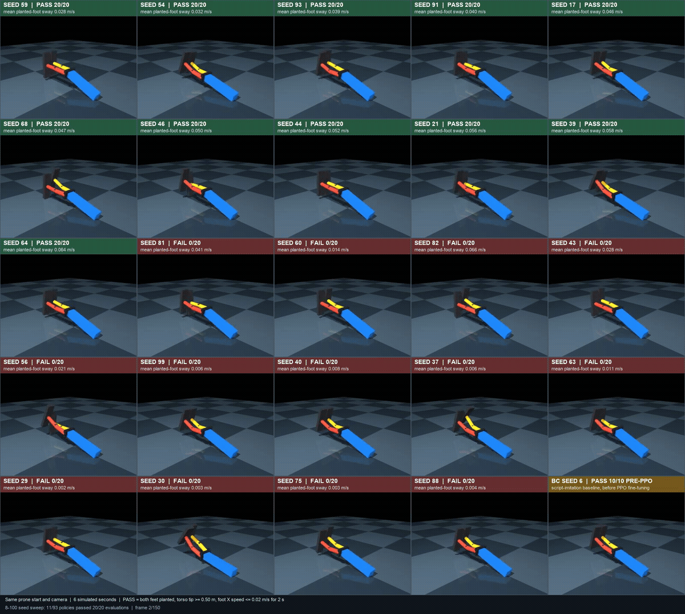

# An overnight RL experiment taught a simulated LEGO biped to stand

## Summary

An overnight run of reinforcement learning found multiple ways for a simulated LEGO-style robot to get up from lying face-down and stand with both feet on the ground.

### What is this?

A LEGO-inspired biped simulated in MuJoCo, a physics simulator. It starts lying face-down and has four powered joints: two hips and two knees. The model is simplified and constrained to move forward and backward; it is not a physical robot.

### Why did we do it?

To learn reinforcement learning and MuJoCo by giving an automated training run a long task to work on overnight.

### How did we do it?

We built a simplified robot model from LEGO/Technic dimensions and added simulated mass, joints, motors, and ground contact. After manually tuning a scripted get-up that worked, we used it to demonstrate the task to the learning system. We then ran 93 separate training attempts overnight, each with a different random seed and 300,000 training steps.

The reward was intentionally simple: raise the top of the torso, keep feet still when they touch the ground, and reward contact from the feet. The exact reward was:

```python
reward = 10.0 * torso_top_z - 5.0 * foot_sway + 2.0 * planted_count
```

### What did it find?

Eleven of the 93 trained policies passed the final test in all 20 tries: both feet on the ground, torso tip at least 0.50 m high, and feet nearly still while holding the stand for two seconds. The best passing policy had average planted-foot sway of 0.028 m/s.

The 5×5 video above shows 25 examples: all 11 passing policies, selected failures, and the scripted demonstration before training. Each clip starts from the same face-down pose.

### What’s next?

Repeat the experiment on more complicated robot designs, while keeping clear tests for what counts as a successful stand.
